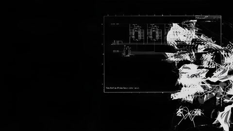
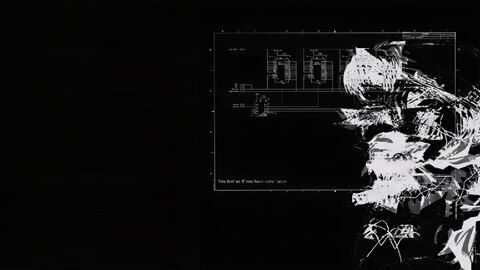
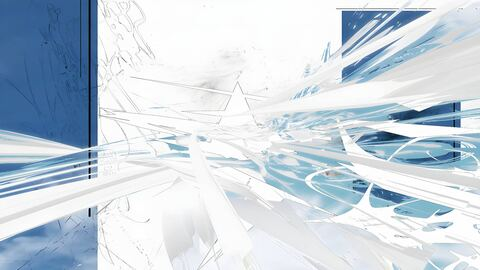
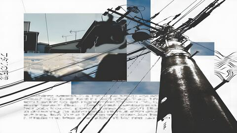
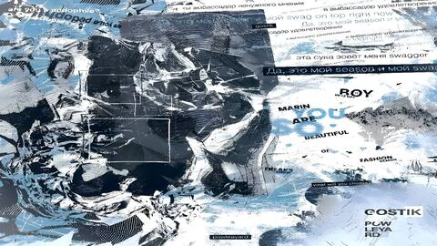
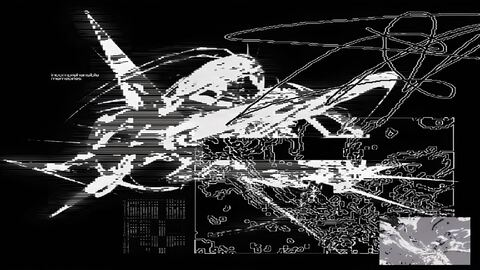

# Collection of Wallpapers

79 wallpapers, sorted by category. Click a preview for the full-resolution file.

## Usage

Download a single image from its preview, or clone the whole collection:

```sh
git clone --depth 1 https://github.com/owainxyz/collection-of-wallpapers
```

Full-resolution files are in `wallpapers/`. Previews in `previews/` are 480×270 JPEG thumbnails.

## Credits

The gradients are original to this collection. Photographs and artwork belong to their original creators and are collected here for personal use. If you own an image and would like it credited or removed, please [open an issue](https://github.com/owainxyz/collection-of-wallpapers/issues).

## Categories

| Category | Count |
| --- | --- |
| [Gradients / Simple](#gradients--simple) | 14 |
| [Gradients / Washed](#gradients--washed) | 16 |
| [Gradients / Complex](#gradients--complex) | 8 |
| [Photos](#photos) | 11 |
| [Flowers / Pink](#flowers--pink) | 6 |
| [Flowers / Purple](#flowers--purple) | 1 |
| [Flowers / Red](#flowers--red) | 2 |
| [Flowers / White](#flowers--white) | 2 |
| [Flowers / Yellow](#flowers--yellow) | 4 |
| [Distros / Void](#distros--void) | 1 |
| [Original](#original) | 14 |

## Gradients / Simple

<table>
<tr>
<td align="center" width="25%"><a href="wallpapers/Gradients/Simple/Ash%20Dark.png"></a><br><sub>Ash Dark</sub></td>
<td align="center" width="25%"><a href="wallpapers/Gradients/Simple/Ash%20Light.png"></a><br><sub>Ash Light</sub></td>
<td align="center" width="25%"><a href="wallpapers/Gradients/Simple/Fog%20Dark.png"></a><br><sub>Fog Dark</sub></td>
<td align="center" width="25%"><a href="wallpapers/Gradients/Simple/Fog%20Light.png"></a><br><sub>Fog Light</sub></td>
</tr>
<tr>
<td align="center" width="25%"><a href="wallpapers/Gradients/Simple/Grey%20Dark.png"></a><br><sub>Grey Dark</sub></td>
<td align="center" width="25%"><a href="wallpapers/Gradients/Simple/Grey%20Light.png"></a><br><sub>Grey Light</sub></td>
<td align="center" width="25%"><a href="wallpapers/Gradients/Simple/Slate%20Dark.png"></a><br><sub>Slate Dark</sub></td>
<td align="center" width="25%"><a href="wallpapers/Gradients/Simple/Slate%20Light.png"></a><br><sub>Slate Light</sub></td>
</tr>
<tr>
<td align="center" width="25%"><a href="wallpapers/Gradients/Simple/Smoke%20Dark.png"></a><br><sub>Smoke Dark</sub></td>
<td align="center" width="25%"><a href="wallpapers/Gradients/Simple/Smoke%20Light.png"></a><br><sub>Smoke Light</sub></td>
<td align="center" width="25%"><a href="wallpapers/Gradients/Simple/Steel%20Dark.png"></a><br><sub>Steel Dark</sub></td>
<td align="center" width="25%"><a href="wallpapers/Gradients/Simple/Steel%20Light.png"></a><br><sub>Steel Light</sub></td>
</tr>
<tr>
<td align="center" width="25%"><a href="wallpapers/Gradients/Simple/Stone%20Dark.png"></a><br><sub>Stone Dark</sub></td>
<td align="center" width="25%"><a href="wallpapers/Gradients/Simple/Stone%20Light.png"></a><br><sub>Stone Light</sub></td>
</tr>
</table>

## Gradients / Washed

<table>
<tr>
<td align="center" width="25%"><a href="wallpapers/Gradients/Washed/Clay%20Dark.png"></a><br><sub>Clay Dark</sub></td>
<td align="center" width="25%"><a href="wallpapers/Gradients/Washed/Clay%20Light.png"></a><br><sub>Clay Light</sub></td>
<td align="center" width="25%"><a href="wallpapers/Gradients/Washed/Lagoon%20Dark.png"></a><br><sub>Lagoon Dark</sub></td>
<td align="center" width="25%"><a href="wallpapers/Gradients/Washed/Lagoon%20Light.png"></a><br><sub>Lagoon Light</sub></td>
</tr>
<tr>
<td align="center" width="25%"><a href="wallpapers/Gradients/Washed/Lilac%20Dark.png"></a><br><sub>Lilac Dark</sub></td>
<td align="center" width="25%"><a href="wallpapers/Gradients/Washed/Lilac%20Light.png"></a><br><sub>Lilac Light</sub></td>
<td align="center" width="25%"><a href="wallpapers/Gradients/Washed/Mist%20Dark.png"></a><br><sub>Mist Dark</sub></td>
<td align="center" width="25%"><a href="wallpapers/Gradients/Washed/Mist%20Light.png"></a><br><sub>Mist Light</sub></td>
</tr>
<tr>
<td align="center" width="25%"><a href="wallpapers/Gradients/Washed/Moss%20Dark.png"></a><br><sub>Moss Dark</sub></td>
<td align="center" width="25%"><a href="wallpapers/Gradients/Washed/Moss%20Light.png"></a><br><sub>Moss Light</sub></td>
<td align="center" width="25%"><a href="wallpapers/Gradients/Washed/Rose%20Dark.png"></a><br><sub>Rose Dark</sub></td>
<td align="center" width="25%"><a href="wallpapers/Gradients/Washed/Rose%20Light.png"></a><br><sub>Rose Light</sub></td>
</tr>
<tr>
<td align="center" width="25%"><a href="wallpapers/Gradients/Washed/Sage%20Dark.png"></a><br><sub>Sage Dark</sub></td>
<td align="center" width="25%"><a href="wallpapers/Gradients/Washed/Sage%20Light.png"></a><br><sub>Sage Light</sub></td>
<td align="center" width="25%"><a href="wallpapers/Gradients/Washed/Sand%20Dark.png"></a><br><sub>Sand Dark</sub></td>
<td align="center" width="25%"><a href="wallpapers/Gradients/Washed/Sand%20Light.png"></a><br><sub>Sand Light</sub></td>
</tr>
</table>

## Gradients / Complex

<table>
<tr>
<td align="center" width="25%"><a href="wallpapers/Gradients/Complex/Dawn%20Dark.png"></a><br><sub>Dawn Dark</sub></td>
<td align="center" width="25%"><a href="wallpapers/Gradients/Complex/Dawn%20Light.png"></a><br><sub>Dawn Light</sub></td>
<td align="center" width="25%"><a href="wallpapers/Gradients/Complex/Dusk%20Dark.png"></a><br><sub>Dusk Dark</sub></td>
<td align="center" width="25%"><a href="wallpapers/Gradients/Complex/Dusk%20Light.png"></a><br><sub>Dusk Light</sub></td>
</tr>
<tr>
<td align="center" width="25%"><a href="wallpapers/Gradients/Complex/Haze%20Dark.png"></a><br><sub>Haze Dark</sub></td>
<td align="center" width="25%"><a href="wallpapers/Gradients/Complex/Haze%20Light.png"></a><br><sub>Haze Light</sub></td>
<td align="center" width="25%"><a href="wallpapers/Gradients/Complex/Tide%20Dark.png"></a><br><sub>Tide Dark</sub></td>
<td align="center" width="25%"><a href="wallpapers/Gradients/Complex/Tide%20Light.png"></a><br><sub>Tide Light</sub></td>
</tr>
</table>

## Photos

<table>
<tr>
<td align="center" width="25%"><a href="wallpapers/Photos/Architecture%201.jpg"></a><br><sub>Architecture 1</sub></td>
<td align="center" width="25%"><a href="wallpapers/Photos/Architecture%202.jpg"></a><br><sub>Architecture 2</sub></td>
<td align="center" width="25%"><a href="wallpapers/Photos/Architecture%203.jpg"></a><br><sub>Architecture 3</sub></td>
<td align="center" width="25%"><a href="wallpapers/Photos/Architecture%204.jpg"></a><br><sub>Architecture 4</sub></td>
</tr>
<tr>
<td align="center" width="25%"><a href="wallpapers/Photos/Architecture%205.jpg"></a><br><sub>Architecture 5</sub></td>
<td align="center" width="25%"><a href="wallpapers/Photos/Architecture%206.jpg"></a><br><sub>Architecture 6</sub></td>
<td align="center" width="25%"><a href="wallpapers/Photos/Architecture%207.jpg"></a><br><sub>Architecture 7</sub></td>
<td align="center" width="25%"><a href="wallpapers/Photos/Architecture%208.jpg"></a><br><sub>Architecture 8</sub></td>
</tr>
<tr>
<td align="center" width="25%"><a href="wallpapers/Photos/Architecture%209.jpg"></a><br><sub>Architecture 9</sub></td>
<td align="center" width="25%"><a href="wallpapers/Photos/Architecture%2010.jpg"></a><br><sub>Architecture 10</sub></td>
<td align="center" width="25%"><a href="wallpapers/Photos/Brown%201.jpg"></a><br><sub>Brown 1</sub></td>
</tr>
</table>

## Flowers / Pink

<table>
<tr>
<td align="center" width="25%"><a href="wallpapers/Flowers/Pink/Blossom%201.jpg"></a><br><sub>Blossom 1</sub></td>
<td align="center" width="25%"><a href="wallpapers/Flowers/Pink/Blossom%202.jpg"></a><br><sub>Blossom 2</sub></td>
<td align="center" width="25%"><a href="wallpapers/Flowers/Pink/Blossom%203.jpg"></a><br><sub>Blossom 3</sub></td>
<td align="center" width="25%"><a href="wallpapers/Flowers/Pink/Blossom%204.jpg"></a><br><sub>Blossom 4</sub></td>
</tr>
<tr>
<td align="center" width="25%"><a href="wallpapers/Flowers/Pink/Blossom%205.jpg"></a><br><sub>Blossom 5</sub></td>
<td align="center" width="25%"><a href="wallpapers/Flowers/Pink/Blossom%207.jpg"></a><br><sub>Blossom 7</sub></td>
</tr>
</table>

## Flowers / Purple

<table>
<tr>
<td align="center" width="25%"><a href="wallpapers/Flowers/Purple/Blossom%206.jpg"></a><br><sub>Blossom 6</sub></td>
</tr>
</table>

## Flowers / Red

<table>
<tr>
<td align="center" width="25%"><a href="wallpapers/Flowers/Red/Flowers%201.jpg"></a><br><sub>Flowers 1</sub></td>
<td align="center" width="25%"><a href="wallpapers/Flowers/Red/Flowers%202.jpg"></a><br><sub>Flowers 2</sub></td>
</tr>
</table>

## Flowers / White

<table>
<tr>
<td align="center" width="25%"><a href="wallpapers/Flowers/White/Blossom%208.jpg"></a><br><sub>Blossom 8</sub></td>
<td align="center" width="25%"><a href="wallpapers/Flowers/White/Flowers%203.jpg"></a><br><sub>Flowers 3</sub></td>
</tr>
</table>

## Flowers / Yellow

<table>
<tr>
<td align="center" width="25%"><a href="wallpapers/Flowers/Yellow/Sunflower%201.jpg"></a><br><sub>Sunflower 1</sub></td>
<td align="center" width="25%"><a href="wallpapers/Flowers/Yellow/Sunflower%202.jpg"></a><br><sub>Sunflower 2</sub></td>
<td align="center" width="25%"><a href="wallpapers/Flowers/Yellow/Sunflower%203.jpg"></a><br><sub>Sunflower 3</sub></td>
<td align="center" width="25%"><a href="wallpapers/Flowers/Yellow/Sunflower%204.jpg"></a><br><sub>Sunflower 4</sub></td>
</tr>
</table>

## Distros / Void

<table>
<tr>
<td align="center" width="25%"><a href="wallpapers/Distros/Void/Void%201.jpg"></a><br><sub>Void 1</sub></td>
</tr>
</table>

## Original

<table>
<tr>
<td align="center" width="25%"><a href="wallpapers/theme-dark.png"></a><br><sub>Theme Dark</sub></td>
<td align="center" width="25%"><a href="wallpapers/theme-light.png"></a><br><sub>Theme Light</sub></td>
<td align="center" width="25%"><a href="wallpapers/wallpaper-01.jpg"></a><br><sub>Wallpaper 01</sub></td>
<td align="center" width="25%"><a href="wallpapers/wallpaper-02.jpg"></a><br><sub>Wallpaper 02</sub></td>
</tr>
<tr>
<td align="center" width="25%"><a href="wallpapers/wallpaper-03.jpg"></a><br><sub>Wallpaper 03</sub></td>
<td align="center" width="25%"><a href="wallpapers/wallpaper-04.jpg"></a><br><sub>Wallpaper 04</sub></td>
<td align="center" width="25%"><a href="wallpapers/wallpaper-05.jpg"></a><br><sub>Wallpaper 05</sub></td>
<td align="center" width="25%"><a href="wallpapers/wallpaper-06.jpg"></a><br><sub>Wallpaper 06</sub></td>
</tr>
<tr>
<td align="center" width="25%"><a href="wallpapers/wallpaper-07.jpg"></a><br><sub>Wallpaper 07</sub></td>
<td align="center" width="25%"><a href="wallpapers/wallpaper-08.jpg"></a><br><sub>Wallpaper 08</sub></td>
<td align="center" width="25%"><a href="wallpapers/wallpaper-09.jpg"></a><br><sub>Wallpaper 09</sub></td>
<td align="center" width="25%"><a href="wallpapers/wallpaper-10.jpg"></a><br><sub>Wallpaper 10</sub></td>
</tr>
<tr>
<td align="center" width="25%"><a href="wallpapers/wallpaper-11.png"></a><br><sub>Wallpaper 11</sub></td>
<td align="center" width="25%"><a href="wallpapers/wallpaper-12.jpg"></a><br><sub>Wallpaper 12</sub></td>
</tr>
</table>
